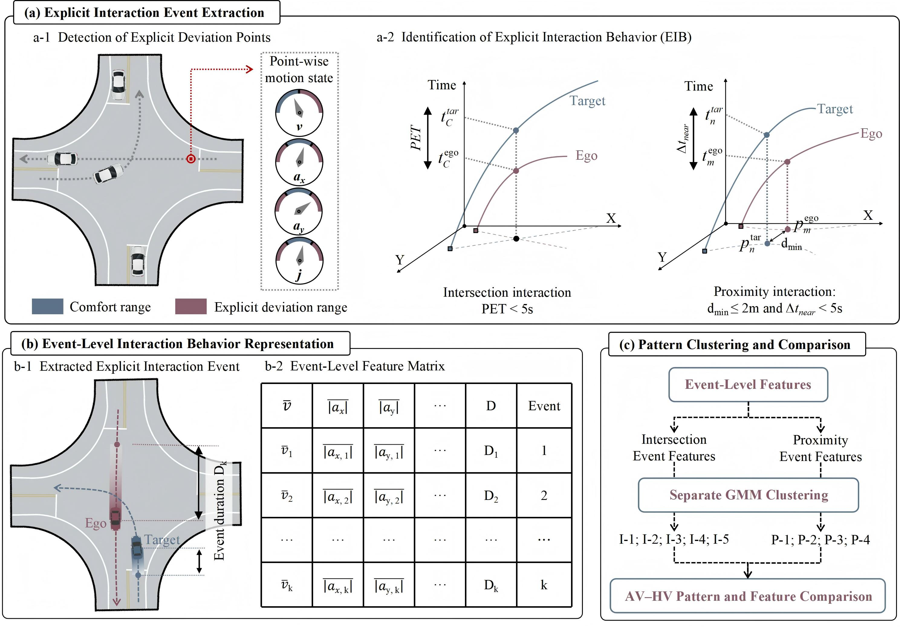

# Contrasting Explicit Interaction Behavior of Autonomous and Human-Driven Vehicles at Signalized Intersections

<p align="center">
  
</p>

## Overview

Autonomous vehicles (AVs) and human-driven vehicles (HVs) interact with motor vehicles, pedestrians, and non-motorized vehicles at signalized intersections. This study defines **explicit interaction behavior (EIB)** as the co-occurrence of ego-vehicle motion-indicator deviations and local spatiotemporal proximity to a target road user, and develops a framework for **event identification, joint feature representation, and AV-HV comparison**.

Using **24 h** of roadside trajectory data from **three signalized intersections in Beijing**, the framework identifies **166,045 interaction events**. Indicator comparisons and Gaussian mixture model clustering use **114,244 complete-feature events**, identifying **five intersection interaction patterns** and **four proximity interaction patterns**.

The analysis compares AVs and HVs at three levels: overall motion and proximity indicators, pattern composition within each target road-user group, and indicator distributions within the same pattern. AVs have lower pooled medians of mean speed and absolute motion-response indicators, while proximity differences vary by target type and interaction pattern. For non-motorized-vehicle targets, the AV share of intersection pattern I-4 is **13.56 percentage points higher** than the HV share, whereas the share of I-5 is **9.10 percentage points lower**.

## Project Page

The interactive project page presents the EIB definition, event statistics, overall comparisons, between-pattern characteristics, and within-pattern AV-HV differences.

**GitHub Pages deployment is pending.** The intended address is:

[https://transmindbjut.github.io/Explicit_Interaction_Behavior/](https://transmindbjut.github.io/Explicit_Interaction_Behavior/)

For local viewing, open `docs/index.html` in a browser. No build step or server is required.

## Repository Structure

```text
.
|-- docs/                         # GitHub Pages site (served from /docs)
|   |-- index.html                # Project homepage
|   |-- .nojekyll                 # Static-site publishing configuration
|   `-- static/
|       |-- academic.css          # Responsive stylesheet
|       |-- app.js                # Interactive figures and pattern shares
|       `-- images/               # Framework, study area, and result figures
|-- .gitignore                    # Publication exclusions
`-- README.md
```

## Authors

Shaobin Yang<sup>1</sup>, Lishan Sun<sup>1</sup>, Pengfei Cui<sup>1*</sup>, Lei Han<sup>2</sup>, Yang Yang<sup>3</sup>, Xingchen Zhang<sup>1</sup>, Rusi Chu<sup>1</sup>

<sup>1</sup> Beijing University of Technology &middot; <sup>2</sup> University of Central Florida &middot; <sup>3</sup> Beijing Jiaotong University

\* Corresponding author: [Pengfei Cui](mailto:pengfeicui@bjut.edu.cn)

## Data Availability

The authors do not have permission to share the raw trajectory data. This repository contains only the project page and figures; the manuscript PDF and processing and analysis code are not included. Processed data are available on request.

## Citation

*To be added upon publication.*
